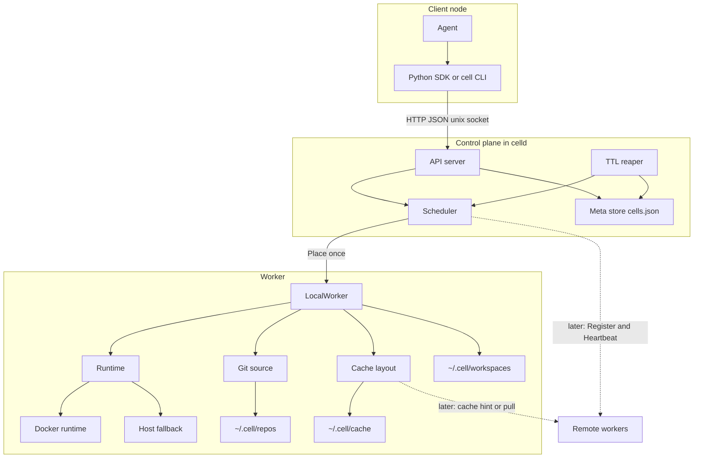
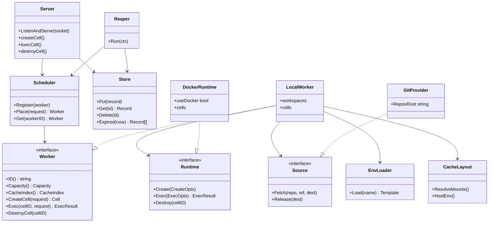
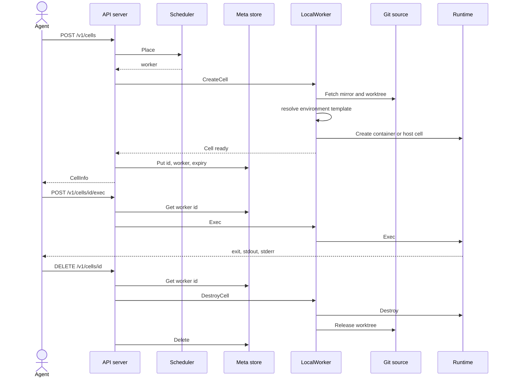

# Cell architecture

Locked design for the Cell runtime. Names match the code (`celld`, `cell`, Python `cell`). The older plan file still says Spark; this document is the current picture.

A **Cell** is a disposable workspace. Caches and git mirrors survive destroy. Mutable workspace state and credentials are not shared.

## What ships now, and what is later

Local MVP is one `celld` process: control plane plus one in-process `LocalWorker` (`celld serve --mode=all`). The agent API is HTTP JSON on a Unix socket (`~/.cell/celld.sock`). The SDK never talks to a worker directly.

`--mode=control` and `--mode=worker` are reserved. Remote `Register` / `Heartbeat`, cross-node cache pull, auth, snapshot/restore, interactive TTY, and a microVM `Runtime` are later. The same `Worker` and `Runtime` interfaces are the plug-in points.

## Network / egress policy (security-first)

Environment templates declare an egress policy. This is not “always offline”.

| Policy | Behavior | Used for |
| --- | --- | --- |
| `default` / `open` | Normal Docker outbound | Agent Cells (`go-1.23`, `python-3.12`) that need modules, docs, APIs |
| `none` | `docker run --network none` | Air-gapped embedded builds (`embedded-zephyr`, `embedded-linux`) |
| `allowlist` | Internal Docker network + `cell-egress` sidecar | No direct egress; HTTP(S) via CONNECT/forward proxy; host allowlist + JSON audit log |

Schema already accepted in templates:

```yaml
network: allowlist
egress:
  allow:
    - proxy.golang.org
    - github.com
```

Until the proxy exists, create with `network: allowlist` fails closed (never silently opens the network). Host fallback rejects `none` and `allowlist` because it cannot enforce them. When Docker is enabled, missing images and missing runtime entries never fall back to the host.

## Security in design (not bolt-on)

Cell is an isolation product. Controls belong in the daemon and `Runtime` implementation:

- Fail closed on unfinished or unenforceable policy (allowlist, host+`none`, Docker+empty image).
- No host escape when Docker is the selected backend; no docker.sock; no privileged / host-namespace shortcuts.
- Docker create path hardens by construction: non-root (`--user` daemon uid/gid), `no-new-privileges`, `--cap-drop=ALL` + minimal add-backs, read-only rootfs + tmpfs, per-Cell cache binds, RO same-path git repos mount. Remaining: allowlist egress proxy, warm trusted cache seed, microVM backend — see [TECH_DEBT.md](TECH_DEBT.md).
- Stronger isolation later is another `Runtime` (microVM stub under `internal/worker/runtime/microvm`), not an SDK change. Egress allowlist is `internal/worker/egress` (stub; create still fail-closed).

Placement order, already in `scheduler.Place`:

1. `prefer_local` (request `client_worker_id`, else the configured local worker)
2. warm `CacheHints`
3. free capacity
4. otherwise reject

Exec and destroy stay on the worker recorded in meta. They are not placed again.

## Component view

Clients may also be workers and share capacity and caches. The control plane places a Cell once. Dedicated workers and peer client-workers are the same role on other machines; only the local worker exists in the MVP.



| Piece | Package | Role |
| --- | --- | --- |
| API server | `internal/control/api` | `GET /health`, `/v1/cells`, exec, `POST /v1/run` |
| Scheduler | `internal/control/scheduler` | Place on create; look up the sticky worker after that |
| Meta store | `internal/control/meta` | `cell_id` to worker, status, TTL; JSON under `~/.cell/state` |
| TTL reaper | `internal/control/reaper` | Tick on start and every 15s; destroy expired Cells |
| LocalWorker | `internal/worker/manager` | Checkout, template, runtime, workspace lifecycle |
| Runtime | `internal/worker/runtime` | `Create` / `Exec` / `Destroy`. Docker first; host fallback when Docker is absent or `CELL_RUNTIME=host` |
| Git source | `internal/worker/source/git` | `clone --mirror`, then worktree. Empty repo is a blank workspace |
| Cache | `internal/worker/cache` | Durable dirs and placement hints |
| Env templates | `internal/worker/envtemplate` | `go-1.23`, `python-3.12`, `embedded-zephyr`, `embedded-linux` |
| Python SDK | `sdk/python` | Primary agent client |
| CLI | `cmd/cell` | Ops: health, list, run, destroy |

## Class view



`DockerRuntime` is the only `Runtime` implementation. It selects Docker when `docker info` works and the template has an image, and host `sh -c` otherwise. A future microVM backend implements `Runtime` and does not change the SDK or the scheduler.

## Create, exec, destroy



`POST /v1/run` is the same three steps in one request: create, exec each command, destroy. The TTL reaper calls the same destroy path for expired records.

## Disk layout

```text
~/.cell/
  celld.sock
  state/cells.json
  repos/<hash>/          bare mirrors, durable
  workspaces/<id>/       disposable
  cache/                 durable: go-mod, go-build, pip-cache, zephyr, yocto, ccache
```

## Open follow-ups

Accepted debt (including Docker sandbox hardening and egress allowlist proxy) is in [TECH_DEBT.md](TECH_DEBT.md). Security stays in design and in the runtime software path. Phase 5 is still the cluster: worker register and heartbeat, `prefer_local` across peers, and optional cross-node cache pull.
